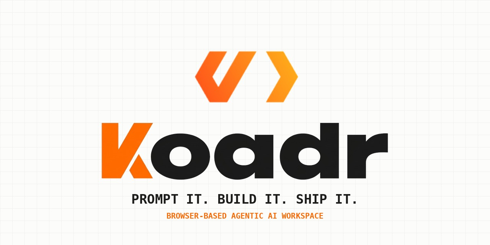

# Koadr

[](https://koadr.iliasgnrs.workers.dev)

**Koadr** is an open-architecture, agentic AI workspace that turns natural language into
production-ready full-stack applications instantly inside your browser. No local setup,
no limits — just prompt it, build it, ship it.

Koadr is model-agnostic: bring your own keys (DeepSeek, Claude, OpenAI, Gemini, Groq,
Ollama, LM Studio and more) and run Node.js in the browser through WebContainers.

- **Live app**: [koadr.iliasgnrs.workers.dev](https://koadr.iliasgnrs.workers.dev)
- **FAQ**: [FAQ.md](FAQ.md)
- **Contributing**: [CONTRIBUTING.md](CONTRIBUTING.md)
- **Agent streaming notes**: [docs/koadr/agent-streaming-fixes.md](docs/koadr/agent-streaming-fixes.md)

---

## Table of Contents

- [Quick Start](#quick-start)
- [Running with Docker](#running-with-docker)
- [Desktop App (Electron)](#desktop-app-electron)
- [Configuring API Keys and Providers](#configuring-api-keys-and-providers)
- [Features](#features)
- [Recent Highlights](#recent-highlights)
- [Available Scripts](#available-scripts)
- [Contributing & Community](#contributing--community)
- [Licensing](#licensing)

---

## Quick Start

### Prerequisites
- **Node.js** >= 22.12.0
- **pnpm** >= 9.15.9 (`npm install -g pnpm`)

### 1. Clone & Install

```bash
git clone https://github.com/iliasgnrs/koadr.git
cd koadr
pnpm install
```

### 2. Run the Development Server

```bash
pnpm run dev
```

Open [http://localhost:5173](http://localhost:5173) in your browser. To run the exact Cloudflare worker runtime locally, use `pnpm run cf:dev` and open [http://localhost:8787](http://localhost:8787).

> **Pre-built Desktop Binaries**: Prefer a standalone app? Download binaries for Windows, macOS, and Linux from our [Latest Releases](https://github.com/iliasgnrs/koadr/releases/latest).

---

## Running with Docker

1. **Configure Environment Variables**:
   ```bash
   cp .env.example .env.local
   ```

2. **Build and Run**:
   ```bash
   # Development mode with hot-reload:
   docker compose --profile development up

   # Production build:
   pnpm run dockerbuild:prod
   docker compose --profile production up
   ```

---

## Desktop App (Electron)

Koadr is also available as a cross-platform desktop application:

- **Download**: Grab pre-built installers from [Latest Releases](https://github.com/iliasgnrs/koadr/releases/latest).
- **Build from Source**:
  ```bash
  pnpm electron:build:dist
  ```

---

## Configuring API Keys and Providers

You can configure model providers either directly in the UI or via environment variables:

### Option A: In the UI (Recommended)
Click the **Settings** icon (⚙️) in the sidebar → **Providers**. Enter your API keys or configure local endpoints (Ollama, LM Studio, OpenAI-compatible). Keys are validated in real time and stored securely in your browser cookies.

### Option B: Environment Variables
Copy `.env.example` to `.env.local` and add your keys or local endpoints:

```bash
# Cloud Providers
ANTHROPIC_API_KEY=your_key_here
OPENAI_API_KEY=your_key_here
GEMINI_API_KEY=your_key_here

# Local Providers
OLLAMA_BASE_URL=http://127.0.0.1:11434
LMSTUDIO_BASE_URL=http://127.0.0.1:1234
```

---

## Features

- **In-Browser Web Development**: Full-stack Node.js development environment powered by WebContainers.
- **22+ AI Providers**: Cloud (Anthropic, OpenAI, Google, DeepSeek, Groq, xAI, Mistral, etc.) and Local (Ollama, LM Studio). OpenRouter, Anthropic, OpenAI, and Google are enabled by default.
- **Interactive Workbench**: Integrated code editor, terminal, visual diff viewer, and real-time live preview. Opens by default for a started chat and can be reopened after closing.
- **Starter Setup**: Explicit framework requests select a matching starter in code. Starter files include detected install and development server commands before the first customization request.
- **Prompt Library**: Choose a system prompt under Settings → Workspace → Features, including Simple Sal for concise guidance and Tiny Tim for smaller models.
- **Project Workflows**: Git cloning/pushing, snapshot restoration, file conflict locking, and ZIP export.
- **Deployments**: One-click deployment to Netlify, Vercel, and GitHub Pages.
- **Database & Visuals**: Supabase integration, data visualization charts, and Model Context Protocol (MCP) tooling.

---

## Recent Highlights

- **Expanded AI & Tooling Ecosystem**: 22+ cloud and local LLM providers, Model Context Protocol (MCP) integration, and voice prompting.
- **Enhanced Code & Project Workflows**: Visual diff inspection, file conflict locking, codebase search, Git integration, and snapshot restoration.
- **Cross-Platform & Deployments**: Native Electron desktop app, Expo (React Native) support, and direct deployment to Netlify, Vercel, and GitHub Pages.
- **Data & Backend Integrations**: Built-in Supabase management, interactive charts, and bulk chat operations.
- **Prompt and Connector Controls**: Select MCP tools from the prompt attachment menu; manage GitHub, GitLab, Netlify, and other service connections under Settings → Integrations → Connectors.

> **Looking Ahead**: Ongoing work includes bug Fixes, dependance updates and fixes for reliability issues no new features are planed.

---

## Available Scripts

| Command | Description |
|---|---|
| `pnpm run dev` | Start development server with hot module reloading |
| `pnpm run build` | Build the application for production (`react-router build`) |
| `pnpm run preview` | Preview production build locally |
| `pnpm test` | Run unit and integration tests with Vitest |
| `pnpm run typecheck` | Run TypeScript type checks (`tsc`) |
| `pnpm run lint` | Run ESLint across the codebase |
| `pnpm run dockerbuild` | Build Docker container for development |
| `pnpm run electron:dev` | Start Electron desktop application in dev mode |
| `pnpm electron:build:dist` | Package Electron desktop app for current OS |

---

## Contributing & Community

- **Contributing**: Contributions are welcome! Read our [Contributing Guide](CONTRIBUTING.md) and [Project Management Guide](./PROJECT.md) to get started.
- **Troubleshooting & FAQ**: Common errors and setup fixes are documented in our [FAQ](FAQ.md) and the [agent streaming notes](docs/koadr/agent-streaming-fixes.md).


---

## Licensing

Koadr is open-source under the MIT License. It utilizes the [WebContainers API](https://webcontainers.io/enterprise), which has specific commercial licensing terms for enterprise deployment.
